# musicbanana

[](https://codecov.io/gh/FionaPreroll/vibe-musicbanana)

A free place for your listening history: scrobbling and listening charts, running in one form or another since 2007.

One small server (Rust, PostgreSQL) takes the plays of your players and of Spotify and turns them into charts, reviews and statistics, in a web interface in English and German, light or dark.

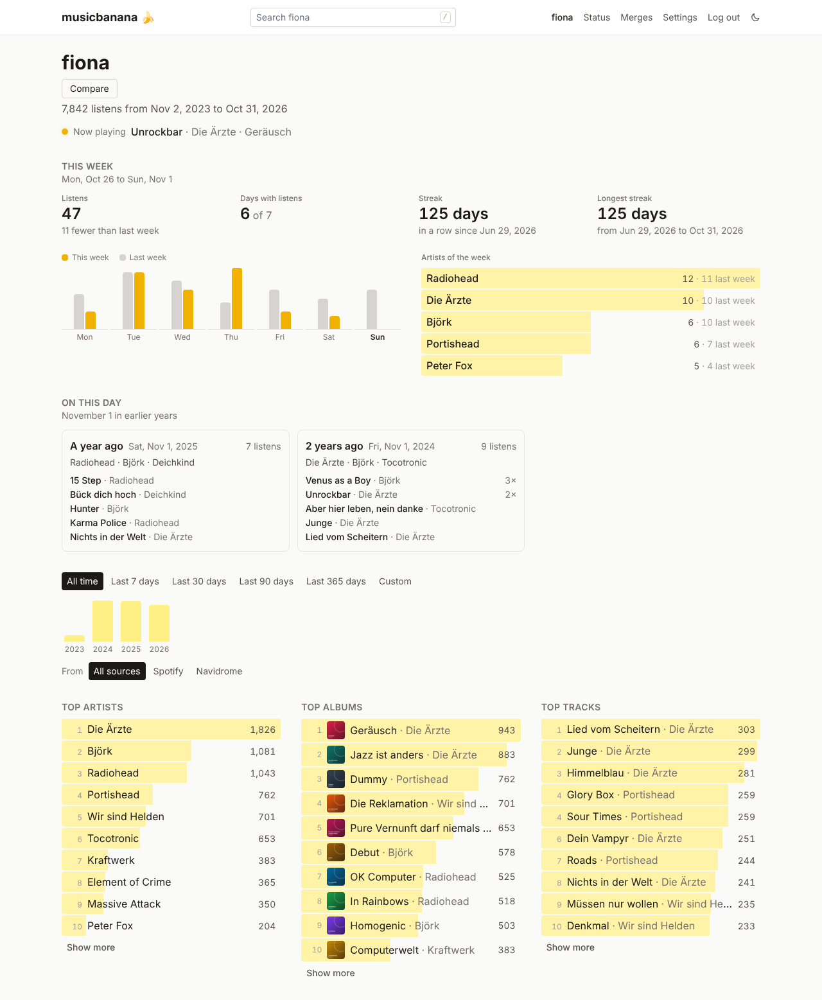

## What it does

- **Collects listens** from every player that speaks the ListenBrainz API, such as Navidrome and the apps that play from it, and from Spotify through [YourSpotify](https://github.com/Yooooomi/your_spotify). Duplicates and plays sent twice are skipped. → [Scrobbling](docs/scrobbling.md), [Spotify](docs/spotify.md)
- **Profile pages** with "This week", "On this day", top artists, albums and tracks for any period with their movement since the period before (↑3, ↓2, new), a listening clock, "Lost & found", a page per artist, album and track, a year in review and a search. → [Pages](docs/pages.md)
- **Compares two profiles**: how much they overlap, what both like, what only one knows. → [Pages](docs/pages.md#comparing-two-profiles)
- **Album covers** from the Cover Art Archive, fetched and kept by the server, off by default. → [Album covers](docs/covers.md)
- **Several accounts and profiles**, each public, for followers or private, with follows, a trash for wrong listens and a download of all your data. → [Accounts and profiles](docs/accounts.md)
- **A tidy catalog**: suggestions for merging spellings of the same artist, album or track (with undo), MusicBrainz IDs from Picard-tagged files, editions such as "Remastered 2009" counted for the plain title. → [Catalog](docs/catalog.md)
- **The old musicbanana's history**: the 2016 PHP database imports with its accounts and passwords. → [Importing the PHP database](docs/import-php.md)

## Screenshots

| | |
|---|---|
| 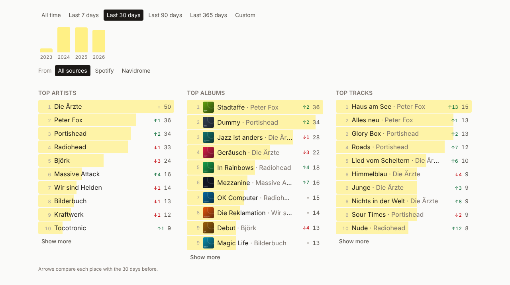 | 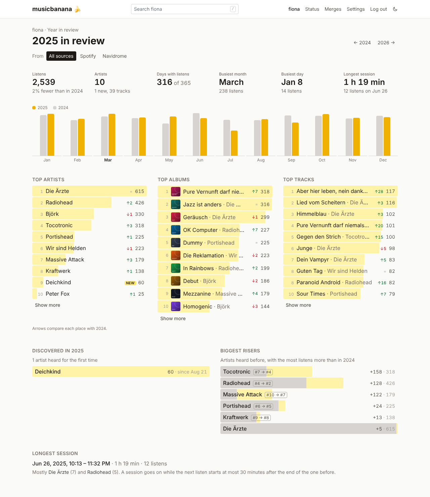 |
| **Charts for any period**, with their movement | **A year in review** |
| 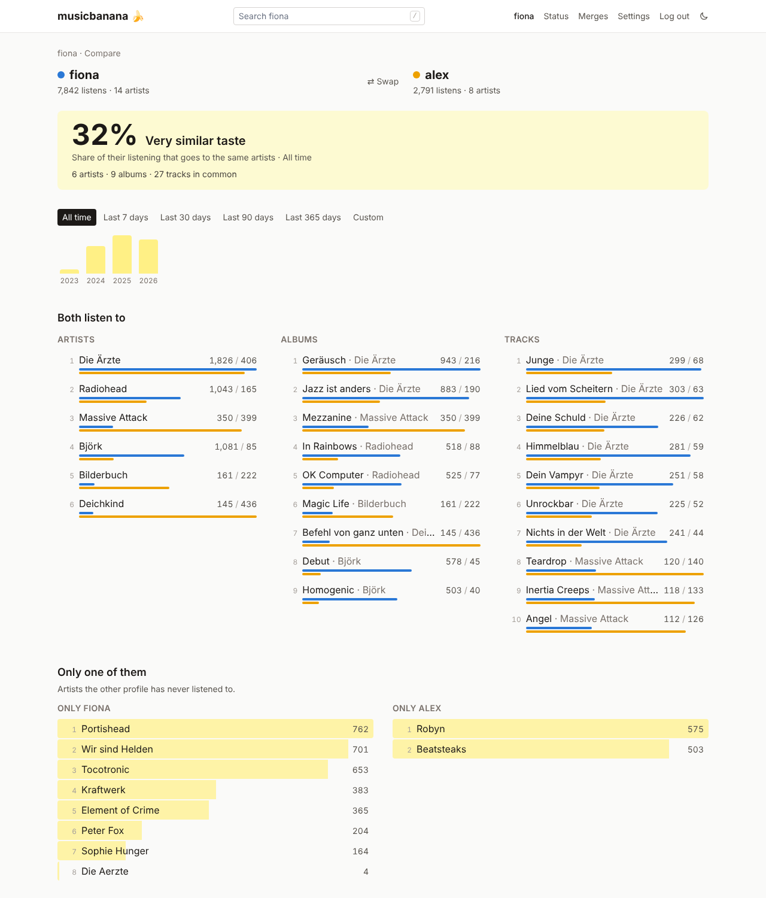 | 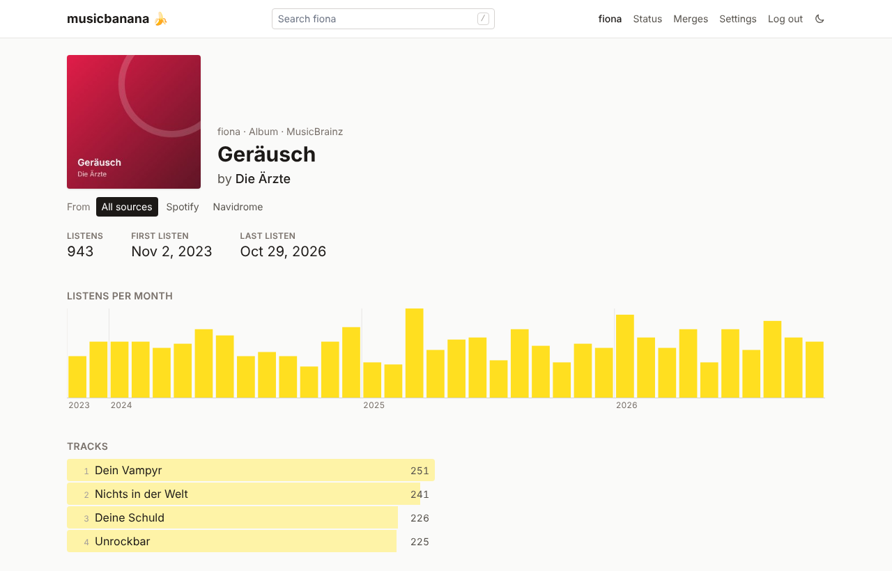 |
| **Comparing two profiles** | **A page per artist, album and track** |
| 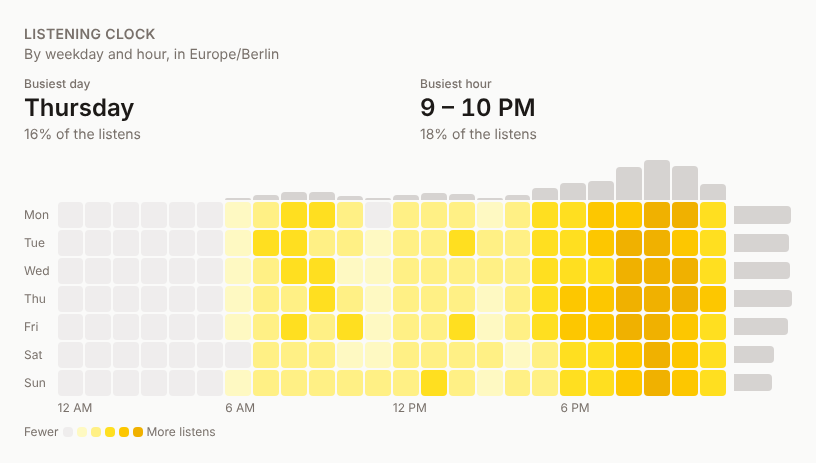 | 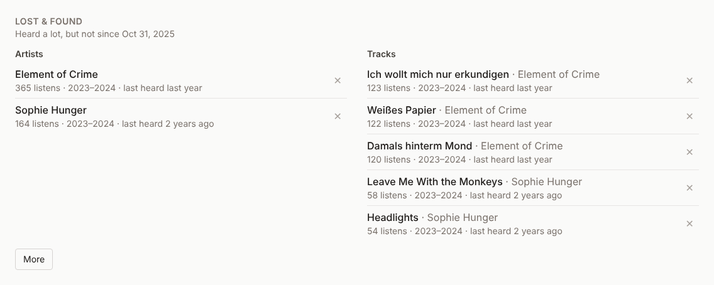 |
| **The listening clock** | **Lost & found** |
| 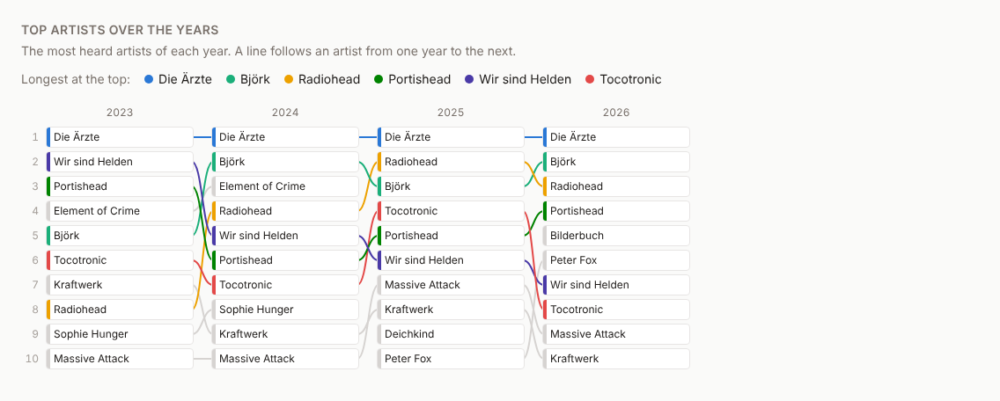 | 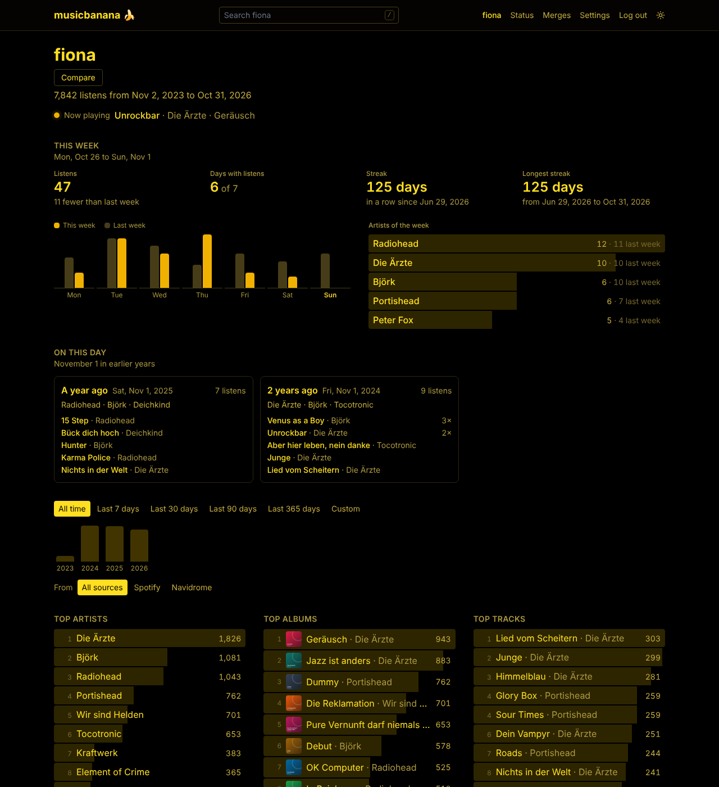 |
| **Top artists over the years** | **Light or dark** |
| 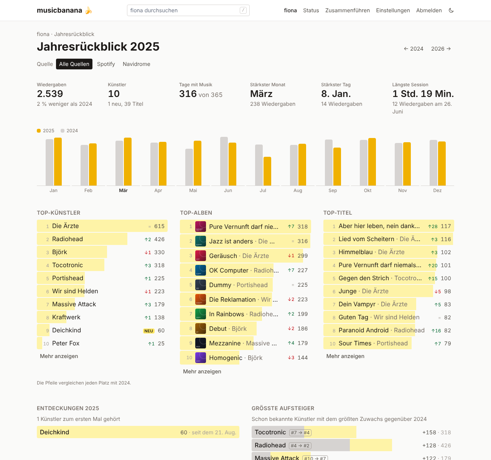 | 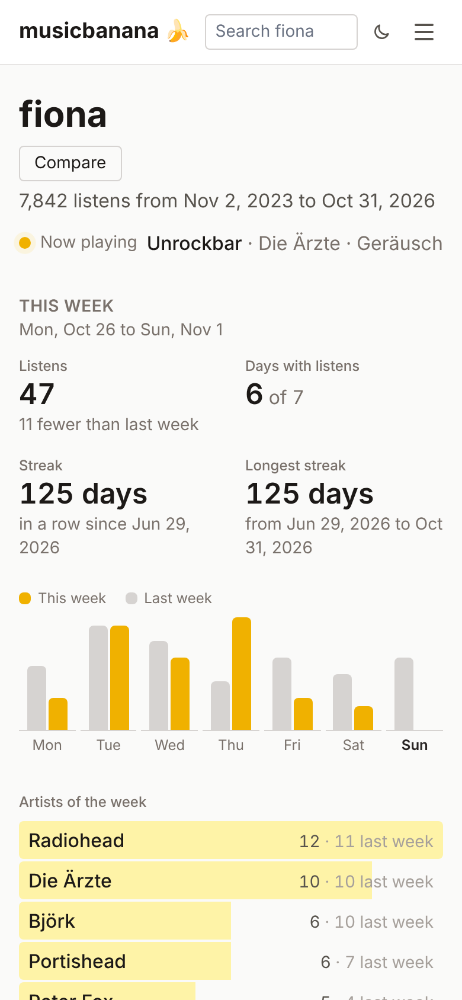 |
| **English or German** | **On the phone** |
| 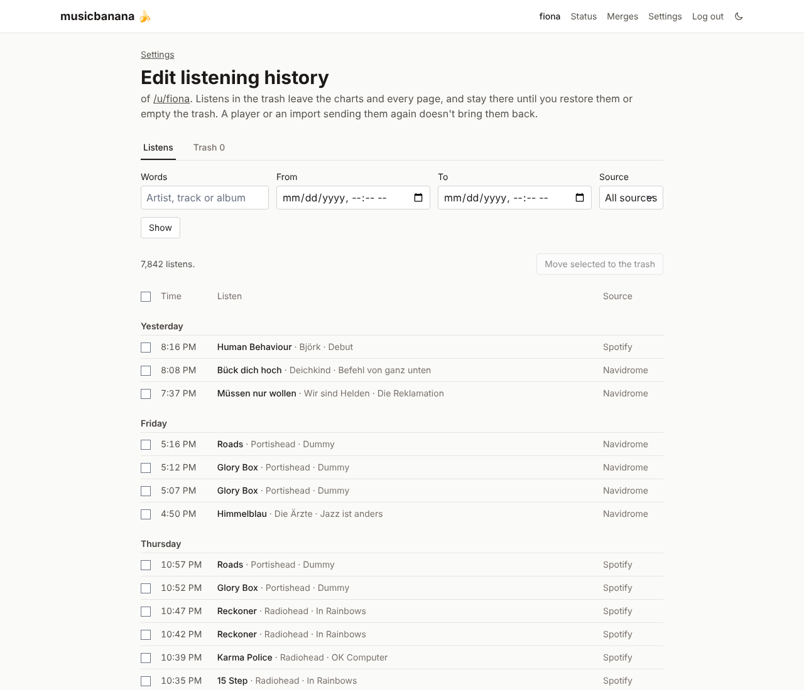 | 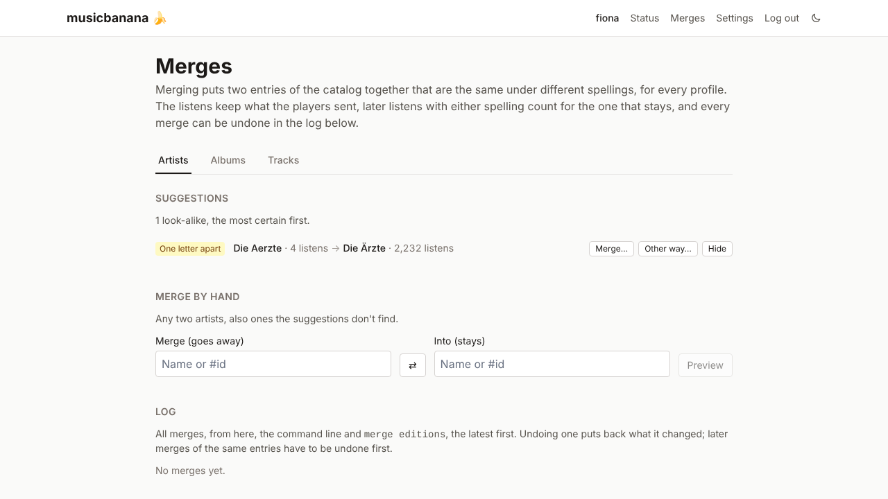 |
| **Editing the listening history** | **Merging spellings** (admins) |

The screenshots show made-up listening histories. The [Screenshots workflow](.github/workflows/screenshots.yml) takes them again and opens a pull request with them, see [Development](docs/development.md#screenshots).

## Quick start

With Docker, next to Navidrome:

```sh
git clone https://github.com/FionaPreroll/vibe-musicbanana.git musicbanana
cd musicbanana/deploy
cp .env.example .env    # set MUSICBANANA_DB_PASSWORD, e.g. to the output of `openssl rand -hex 24`
docker login ghcr.io    # once: your GitHub user name, and a token with read:packages as password
docker compose pull && docker compose up -d
docker compose exec -it musicbanana musicbanana account create <username> --email <address>
```

Then open `http://<server>:3000`, log in, make a scrobble token in the settings and give it to Navidrome. Updates: `docker compose pull && docker compose up -d`.

## Documentation

| | |
|---|---|
| [Installation and operation](docs/installation.md) | Docker, without Docker, all settings, updates, backups, logs, status page |
| [Scrobbling](docs/scrobbling.md) | Tokens, Navidrome, other ListenBrainz clients, MusicBrainz IDs |
| [Spotify via YourSpotify](docs/spotify.md) | Connections the server keeps up to date, the importer |
| [Accounts and profiles](docs/accounts.md) | Accounts on the command line, profiles, visibility, follows, settings, trash, export, logins |
| [Pages](docs/pages.md) | What each page shows and how its numbers come about |
| [Album covers](docs/covers.md) | How covers are fetched and kept, and what leaves the server |
| [Catalog](docs/catalog.md) | Merging duplicates, editions, renaming, MusicBrainz IDs by hand |
| [Importing the PHP database](docs/import-php.md) | The 2016 musicbanana-php database |
| [API](docs/api.md) | Every route of `/api`, with its parameters |
| [Development](docs/development.md) | Layout, local setup, SQL, checks, tests, coverage, translations |
| [Design notes](docs/design.md) | Data model and decisions (German) |

## Development

Rust (stable), Node 22+, pnpm and Docker (or any PostgreSQL 16+):

```sh
docker compose up -d db && cp backend/.env.example backend/.env
cd backend && cargo run                       # API on http://127.0.0.1:3000
cd frontend && pnpm install && pnpm dev       # UI on http://localhost:5173
```

Everything else, from the query cache to the tests: [docs/development.md](docs/development.md).
